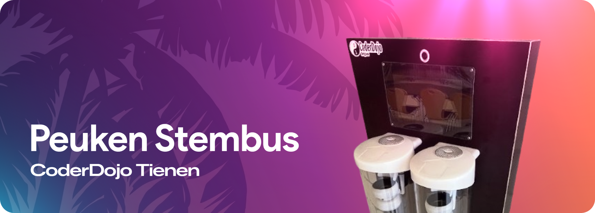

# Peuken Stembus runtime (YOLO11)

Counts cigarette butts. A cup holder sits under a camera with a ring light. When something is placed in it, the camera checks if it is a butt. If yes, the counter goes up by one and is sent over MQTT to the screen Pi. Afterwards the servo flips the cup.

## How it works

1. Startup: camera, ring light, servo and MQTT are initialised. The cup holder must be **empty**, because the first frame becomes the reference.
2. Idle: every frame is compared to the empty reference inside the crop area. After 3 frames in a row that differ, a cup counts as present.
3. Scan: light on, buffered frames discarded, then 3 frames are classified by the YOLO11 classification model.
4. Vote: if at least 2 of 3 frames score `threshold` or higher for the `butt` class, it is a butt.
5. Result: state and counter are published, the ring light flashes green (butt) or red (not a butt), and the counter is saved to `../Debug/counter.txt` only when a butt was counted.
6. Reset: the servo flips, a new empty reference is taken, state goes back to idle.

## Files

| File | Purpose |
|---|---|
| `runtime.py` | Main program (detection, YOLO scan, counter, MQTT, servo) |
| `CMqtt.py` | MQTT client, reconnects by itself, works with paho-mqtt 1.x and 2.x |
| `common.py` | Logger, writes to `../Debug/mylogger.txt` |
| `config.yaml` | All settings |
| `prepare_dataset.py` | Crops photos and splits them into train/val for training |
| `CConfig.py`, `cam_illum.py`, `servo_control.py` | Unchanged from the old code (config loader, NeoPixel ring, servo) |
| `0_takePictures.py` | Take training photos with the real rig |
| `check_install.py` | Checks libraries, camera, ring light access, broker and model |
| `../install.sh`, `../requirements.txt` | Installer and Python dependencies |

## Install (Raspberry Pi 5, Raspberry Pi OS 64-bit)

Copy this folder to the Pi, then:

```bash
cd peuken-mqtt
chmod +x install.sh
./install.sh            # add --service to start at boot
sudo reboot
```

The installer:
1. installs the system packages (picamera2, OpenCV, numpy, gpiozero, lgpio),
2. creates the folders `Data`, `Debug`, `Dataset`, `Images/Originals/butt|not_butt`,
3. creates a venv (with access to the system picamera2) and installs `requirements.txt`,
4. adds a udev rule so the NeoPixel ring works without sudo, and adds your user to the `gpio` and `video` groups,
5. optionally installs a systemd service (`--service`, sets `headless: True`, starts once `Data/butt_cls.pt` exists),
6. runs `src_runtime/check_install.py`.

Check the setup at any time:

```bash
cd src_runtime && ../venv/bin/python check_install.py
```

Notes:
- If `/dev/pio0` is missing, update the firmware: `sudo apt full-upgrade -y && sudo rpi-eeprom-update -a && sudo reboot`.
- Edit the MQTT broker address and credentials in `src_runtime/config.yaml` before the first run.
- The installer replaces `python3-rpi.gpio` with `python3-rpi-lgpio` (already the default on Pi 5 images). The old RPi.GPIO does not work on the Pi 5.

## Train the model

Run all commands below from `src_runtime` with `source ../venv/bin/activate`.

1. Take 300+ photos per class with the real rig (same light, camera, distance):
   ```bash
   python 0_takePictures.py -d ../Images/Originals/butt
   python 0_takePictures.py -d ../Images/Originals/not_butt
   ```
   Fill `not_butt` with hard negatives: empty cup, whole cigarettes, filters, paper, ash, bottle caps, gum.
2. Crop and split:
   ```bash
   python prepare_dataset.py
   ```
   Result: `../Dataset/train|val/butt|not_butt`.
3. Train (on a PC or Colab is faster):
   ```bash
   yolo classify train model=yolo11n-cls.pt data=../Dataset imgsz=224 epochs=50
   ```
4. Copy `runs/classify/train/weights/best.pt` to `Data/butt_cls.pt`.

Class names come from the folder names, so they must be `butt` and `not_butt`.

## Run

```bash
cd src_runtime
../venv/bin/python runtime.py
```

With `headless: False` a preview window opens and ESC stops the program. Set `headless: True` when running without a screen.

## Configuration (`config.yaml`)

| Key | Meaning |
|---|---|
| `mycounter` | Which counter this Pi is (1 or 2), used in the MQTT topics |
| `mqtt` | Broker address, port, user, password |
| `servo` | GPIO pin and min/max duty cycle |
| `illum` | Ring light brightness per phase, flash time |
| `detection` | Cup presence method (`images` or `profiles`), thresholds, crop area (`crop_w` and `crop_h` are end coordinates) |
| `yolo.model` | Path to the trained model |
| `yolo.class_name` | Class that counts (`butt`) |
| `yolo.imgsz` | Model input size (224) |
| `yolo.frames` / `yolo.min_votes` | Frames per scan and votes needed |
| `yolo.threshold` | Minimum confidence per frame (0.7) |
| `yolo.save_debug_images` | Save every scanned crop to `../Debug` |

## MQTT topics

| Topic | Direction | Payload |
|---|---|---|
| `counter/<n>` | published, retained | Current count |
| `state/<n>` | published | 0 idle, 1 analysing, 2 butt, 3 not a butt |
| `set_counter/<n>` | subscribed | New count (for example a reset to 0) |

## Tuning and troubleshooting

- Too many misses: lower `yolo.threshold` or collect more photos of the failing cases.
- Too many false counts: raise `yolo.threshold` or add the wrongly accepted images from `../Debug` to `not_butt` and retrain.
- Scans trigger on an empty holder: raise `min_area_difference` (method `images`) or `min_mean_difference` (method `profiles`).
- Nothing arrives on the screen Pi: check broker address and credentials, and the topic names above. The log is in `../Debug/mylogger.txt`.
- Debug crops in `../Debug` are already cropped. `prepare_dataset.py` detects this and does not crop them again.
